[English](README.md) · [Português](README.pt.md) · [Español](README.es.md) · **Deutsch** · [简体中文](README.zh-CN.md)

<p align="center"></p>

<h1 align="center">Grimório</h1>

**Baue, teste und lass deine Magic: The Gathering-Decks gegeneinander antreten – mit erklärten Vorschlägen, echten Partien KI gegen KI und Partien, die du selbst gegen Forge spielst.**

Grimório ist ein kostenloser Deckbuilder für alle Formate (Commander, Modern, Pauper, Standard, Legacy, …), der auf
deinem eigenen Computer läuft. Er verknüpft Kartentexte, echte Turnierdecks, EDHREC-Daten und Combos aus Commander
Spellbook, um dir Karten vorzuschlagen *und zu erklären, warum*. Außerdem spielt er dein Deck mit der Open-Source-Regelengine
[Forge](https://github.com/Card-Forge/forge) gegen andere Decks: Du kannst die Partien anschauen, einen Bericht lesen
und deine Liste verbessern.

Du kannst dich auch selbst an den Tisch setzen: Spiel auf Grimórios eigenem Spieltisch gegen Forge, veranstalte Turniere,
Ligen und Meisterschaften mit Rangliste und öffne Online-Räume für deine Freunde.

Die Oberfläche gibt es auf **English** (Standard), **Português**, **Español**, **Deutsch** und **简体中文**
(Einstellungen › Sprache).

## Screenshots

<table>
<tr><td width="50%"><a href="docs/img/home.jpg">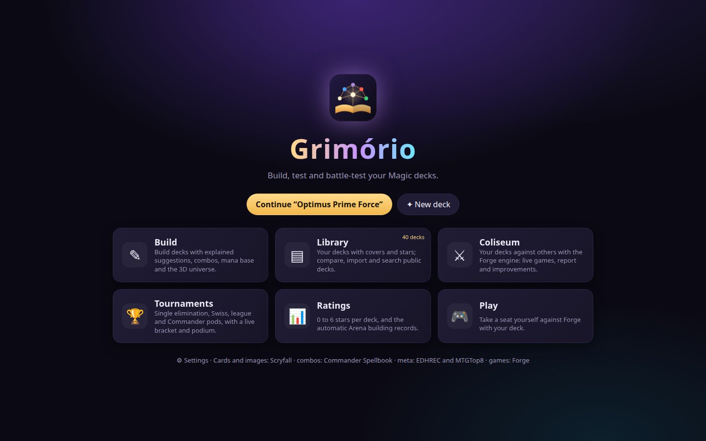</a><br><sub>Startseite</sub></td><td width="50%"><a href="docs/img/build.jpg">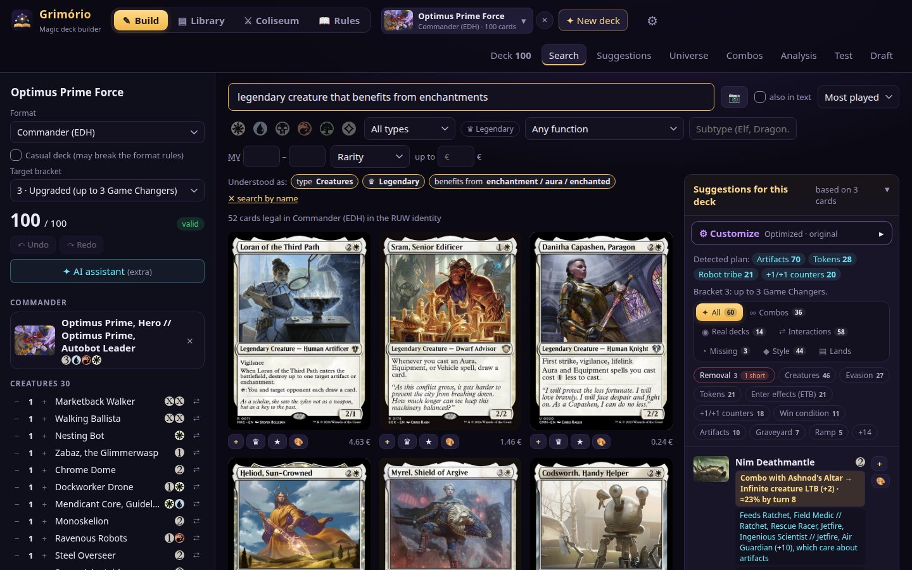</a><br><sub>Bauen: Suche in Worten in jeder Sprache, Deckliste und Vorschläge</sub></td></tr>
<tr><td width="50%"><a href="docs/img/suggestions.jpg">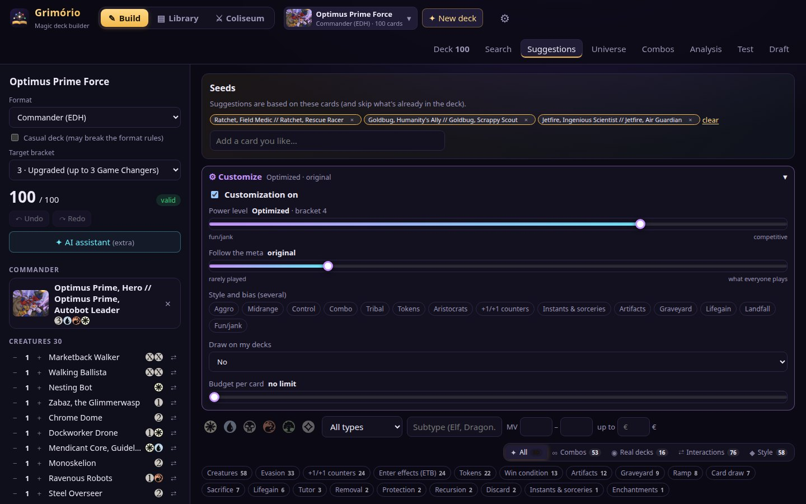</a><br><sub>Vorschläge nach Rolle, Combos und echte Decks</sub></td><td width="50%"><a href="docs/img/analysis.jpg">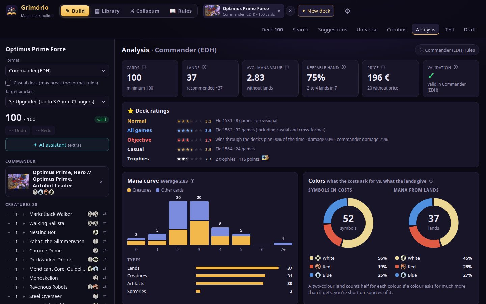</a><br><sub>Analyse: Kurve, Farben, Starthand-Wahrscheinlichkeiten und wie das Deck gewinnt</sub></td></tr>
<tr><td width="50%"><a href="docs/img/universe.jpg">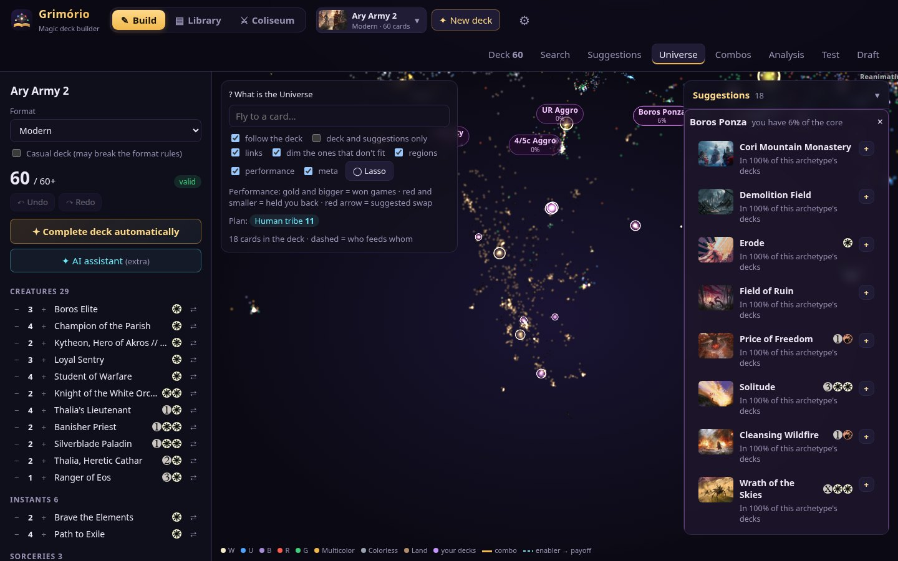</a><br><sub>Universum: die 3D-Karte aller Karten</sub></td><td width="50%"><a href="docs/img/library.jpg">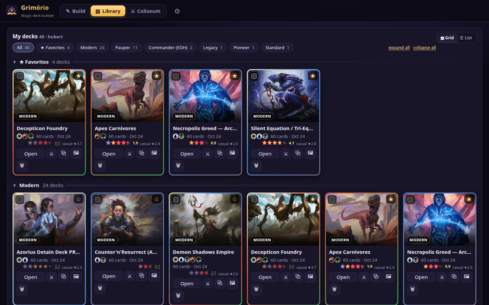</a><br><sub>Bibliothek mit Covern, Sternen, Trophäen und Vergleich</sub></td></tr>
<tr><td width="50%"><a href="docs/img/game.jpg">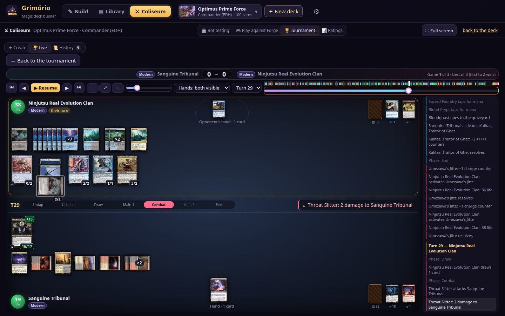</a><br><sub>Kolosseum: sieh Forge dein Deck spielen, mit dem Stapel live</sub></td><td width="50%"><a href="docs/img/forgeplay.jpg">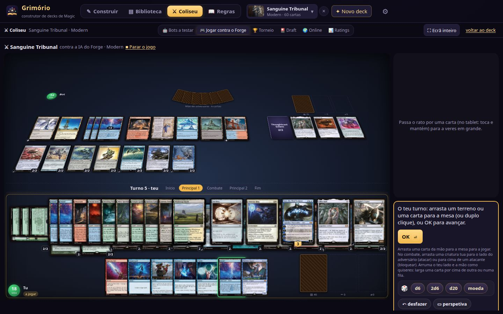</a><br><sub>Spiel selbst auf Grimórios Spieltisch gegen Forge</sub></td></tr>
<tr><td width="50%"><a href="docs/img/tournament.jpg">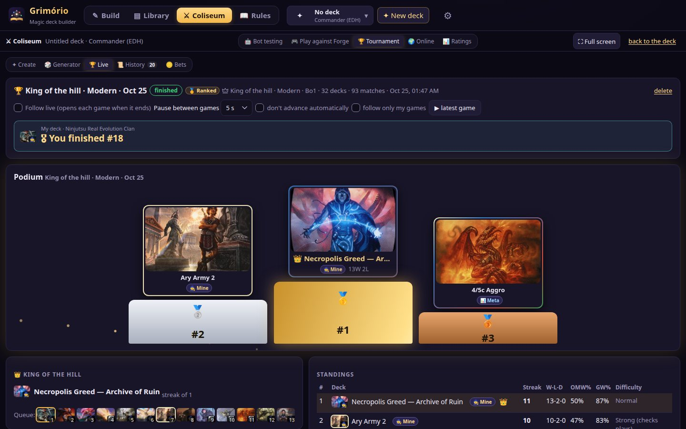</a><br><sub>Turniere: Live-Podium, Tabelle und Herkunfts-Tags der Decks</sub></td><td width="50%"><a href="docs/img/online.jpg">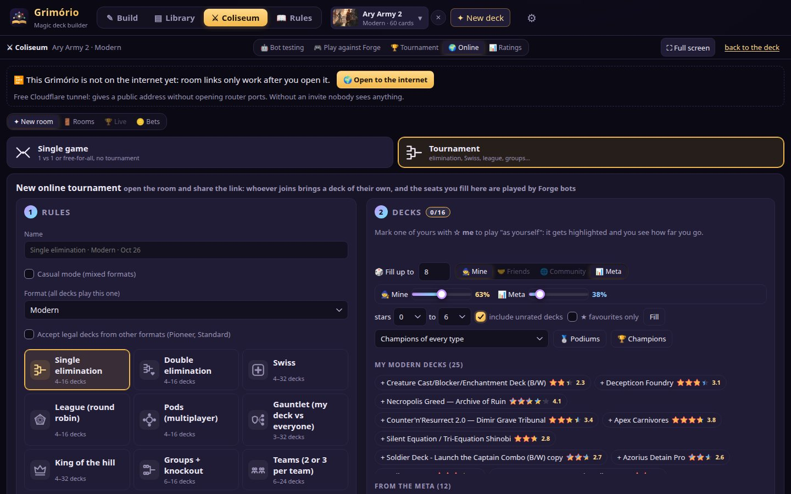</a><br><sub>Online-Räume: einzelne Partien oder Turniere über einen öffentlichen Link</sub></td></tr>
<tr><td width="50%"><a href="docs/img/ratings.jpg">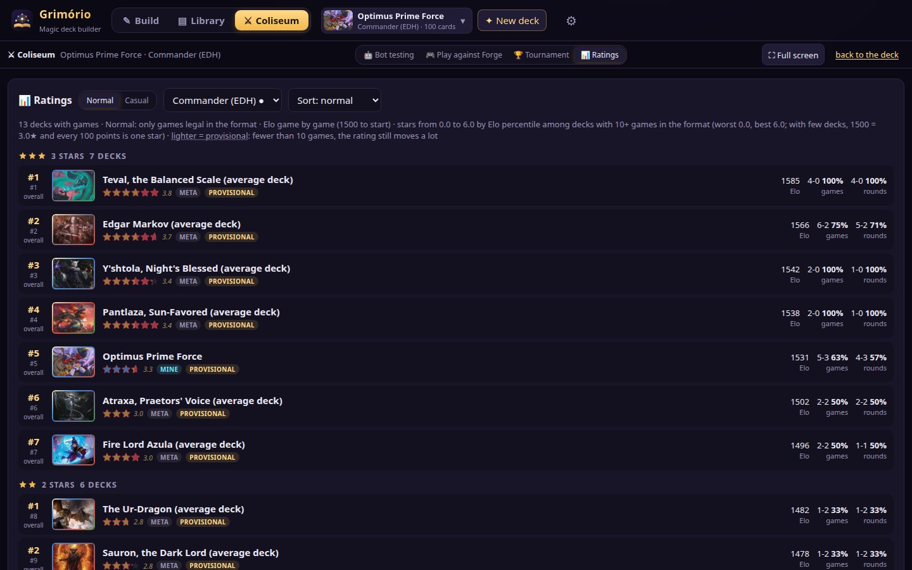</a><br><sub>Ratings: Sterne pro Deck und die automatische Arena</sub></td><td width="50%"><a href="docs/img/table.jpg">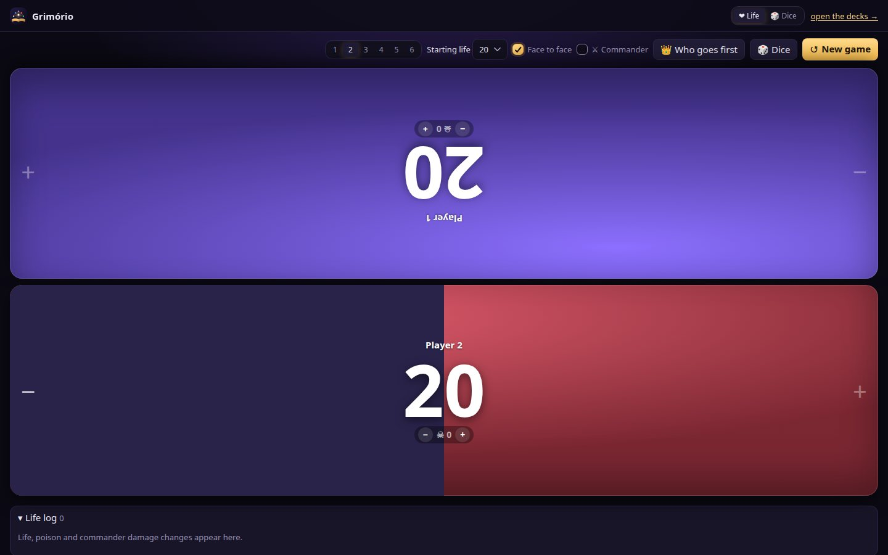</a><br><sub>Am Tisch: Lebenszähler, 3D-Würfel und Kartenscanner</sub></td></tr>
<tr><td width="50%"><a href="docs/img/draft.jpg">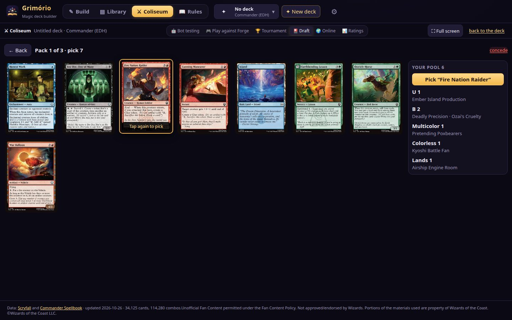</a><br><sub>Draft und Sealed: echte Packs, Forge-Bots und danach ein Turnier</sub></td><td width="50%"><a href="docs/img/sideboard.jpg">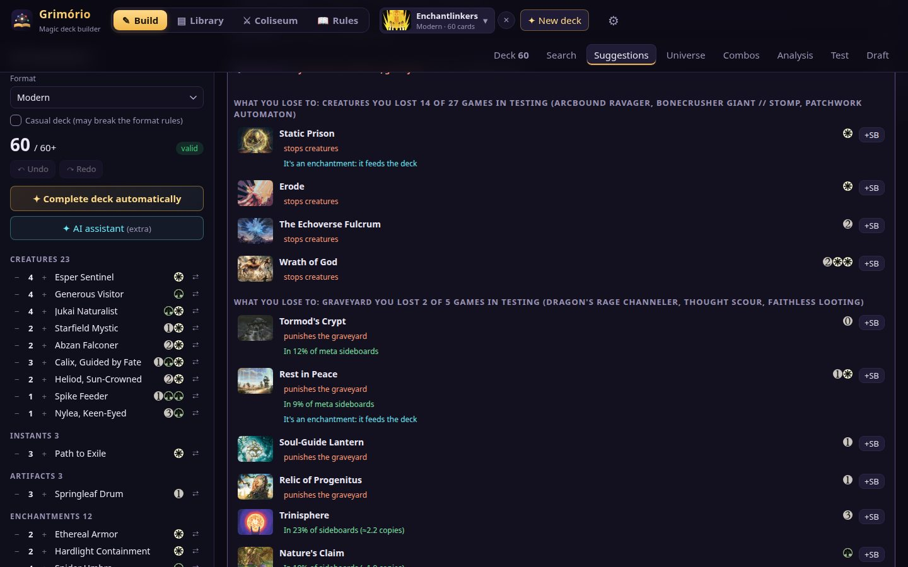</a><br><sub>Sideboard: Antworten auf das, wogegen du in Tests verlierst</sub></td></tr>
<tr><td width="50%"><a href="docs/img/freetable.jpg">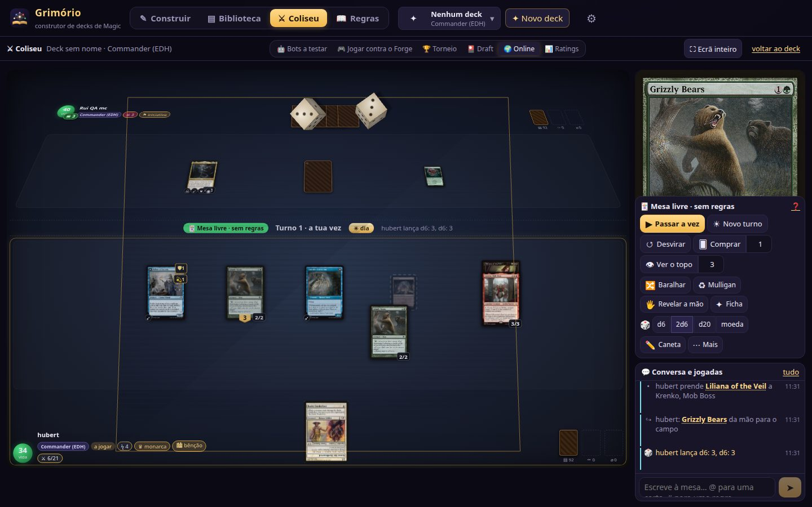</a><br><sub>Freier Tisch online: Perspektive, Würfel, Chat mit Kartenerwähnungen</sub></td><td width="50%"><a href="docs/img/teams.jpg">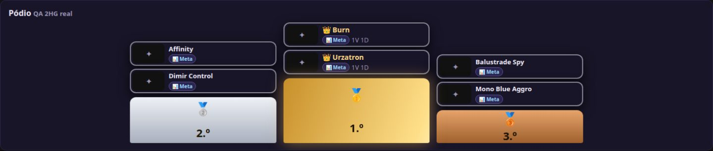</a><br><sub>Teamturniere: am selben Tisch und Two-Headed Giant</sub></td></tr>
</table>

## Installation

**Windows und Linux:** Lade das Paket unter [Releases](https://github.com/hubertdungen/grimorio/releases) herunter,
entpacke es und starte `Grimorio.exe` (Windows) oder `./grimorio` (Linux). Unter Windows öffnet sich Grimório in einem
eigenen App-Fenster, unter Linux in deinem Browser. Schritt-für-Schritt-Anleitung für alle:
**[docs/INSTALL.de.md](docs/INSTALL.de.md)**.

**Updates:** Die Pakete aktualisieren sich selbst. Eine neue Version wird im Hintergrund heruntergeladen (und anhand
ihrer sha256 geprüft) und startet, wenn du Grimório das nächste Mal öffnest; unter Einstellungen › Updates schaltest du
das ab. Deine Decks, Partien, Turniere und Ratings liegen außerhalb des App-Ordners und gehen in jede neue Version mit,
und bevor eine neue Version die Datenbank öffnet, landet eine Kopie in `backups/`.

Beim ersten Start fragt Grimório *Wer spielt?*: Jede Person legt ein Profil mit ihrem Namen an, und ihre Decks, Tests,
Turniere und Ratings bleiben getrennt. Mehrere Leute können sich eine Installation teilen.

Du willst Grimório auf einem Heimserver für mehrere Geräte betreiben oder daran mitentwickeln? Dann lies
[Entwickler-Setup](#entwickler-setup).

## Auf deinem eigenen Linux-Server (Docker)

Betreibe Grimório auf einem Heimserver (Mini-PC, alter Laptop, NAS mit Linux) und öffne es auf allen Handys, Tablets
und Computern im Haus. Das Kolosseum führt Forge in **Docker** aus, und *Gegen Forge spielen* läuft im Browser. Entwickelt
auf Ubuntu 24.04 (andere aktuelle Debian/Ubuntu sollten gehen); braucht ~4 GB freien RAM für Spiele und ~3 GB Speicher.

```bash
# 1. Git, Python, Node.js 22 and Docker
sudo apt update && sudo apt install -y git python3 bzip2 curl unzip
curl -fsSL https://deb.nodesource.com/setup_22.x | sudo -E bash - && sudo apt install -y nodejs
curl -fsSL https://get.docker.com | sh && sudo usermod -aG docker $USER   # danach ab- und wieder anmelden

# 2. Grimório
git clone https://github.com/hubertdungen/grimorio.git && cd grimorio
D=~/.local/share/grimorio && mkdir -p $D/forge

# 3. Forge 2.0.15 (die Regel-Engine)
curl -L https://github.com/Card-Forge/forge/releases/download/forge-2.0.15/forge-installer-2.0.15.tar.bz2 | tar -xj -C $D/forge

# 4. Kartendaten, fertig aus dem neuesten Release (oder selbst bauen mit build/build.sh, ~45 Min.)
curl -L -o /tmp/grimorio-data.zip https://github.com/hubertdungen/grimorio/releases/latest/download/grimorio-data.zip
unzip -o /tmp/grimorio-data.zip -d $D

# 5. Web-App bauen und nach ~/.local/share/grimorio/app installieren
(cd web && npm ci) && ./deploy.sh

# 6. Starten und http://SERVER-IP:8107 auf jedem Gerät im Haus öffnen
python3 $D/app/server.py --host 0.0.0.0 --port 8107
```

**Mit dem Server starten** (systemd-Benutzerdienst):

```ini
# ~/.config/systemd/user/grimorio.service
[Unit]
Description=Grimório
After=network-online.target

[Service]
ExecStart=/usr/bin/python3 %h/.local/share/grimorio/app/server.py --host 0.0.0.0 --port 8107
Restart=on-failure

[Install]
WantedBy=default.target
```

```bash
systemctl --user daemon-reload && systemctl --user enable --now grimorio
sudo loginctl enable-linger $USER   # läuft weiter, nachdem du dich abgemeldet hast
```

- **Wer spielt:** Standardmäßig wählt oder erstellt jede Person ein Profil („Wer spielt?“). Für einen einzigen Nutzer
  `--owner deinname` ergänzen.
- **Von unterwegs:** Port 8107 nie einfach ins Internet öffnen. Stelle ihn hinter ein Login (Reverse-Proxy wie Caddy +
  Authelia, Cloudflare Tunnel mit Access oder Tailscale); der Nutzer kommt im Header `Remote-User` an und jede Person hat
  ihre eigenen Decks.
- **Aktualisieren:** `cd grimorio && git pull && ./deploy.sh`, dann `systemctl --user restart grimorio`.
- **Sicherungen:** siehe nächsten Abschnitt.

## Sicherungen und Cloud-Sync

Alles, was du erstellst, liegt in deiner eigenen Installation (`grimorio.db` im Datenordner). Es gibt zwei optionale,
kostenlose Wege, es zu sichern, beide unter **Einstellungen › Daten & Sicherungen**:

- **Alles exportieren** lädt eine `.grimorio`-Datei herunter (Decks, Profile, Tests, Turniere, Wetten, Ratings und
  deine Deck-Cover). **Importieren** stellt sie wieder her: standardmäßig wird *zusammengeführt* (nichts geht verloren,
  die neueste Version jedes Decks gewinnt) oder alles *ersetzt*; deine aktuellen Daten werden vorher immer daneben
  gesichert (`grimorio.db.before-import-…`).
- **Mit einem Cloud-Ordner synchronisieren** hält mehrere Computer auf dem gleichen Stand – mit jeder kostenlosen App,
  die einen Ordner synchronisiert. Grimório arbeitet immer mit seiner lokalen Kopie und funktioniert daher auch offline
  (z. B. im Flugzeug): die App lädt die Änderungen hoch und herunter, sobald du wieder online bist. Jeder Computer
  schreibt nur seine eigene Datei in diesen Ordner und führt die der anderen zusammen.

| Kostenlose App | Freier Speicher | Konto | Windows / macOS / Linux / Android |
|---|---|---|---|
| Google Drive für den Computer | 15 GB (mit Gmail geteilt) | Google | ✓ / ✓ / — (Syncthing oder Nextcloud nehmen) / App |
| OneDrive | 5 GB | Microsoft | ✓ (eingebaut) / ✓ / inoffizieller Client / App |
| Dropbox | 2 GB | Dropbox | ✓ / ✓ / ✓ / App |
| Syncthing | unbegrenzt (keine Cloud: deine Geräte synchronisieren direkt) | keins | ✓ / ✓ / ✓ / Syncthing-Fork |
| Nextcloud | je nach Anbieter, oder dein eigener Server | Nextcloud | ✓ / ✓ / ✓ / App |
| iCloud Drive | 5 GB | Apple | iCloud für Windows / ✓ / — / — |

**Google Drive in 3 Schritten.** 1) *Google Drive für den Computer* installieren und anmelden (unter Windows erscheint
das Laufwerk `G:` mit *Meine Ablage*). 2) In Grimório: Einstellungen › Daten & Sicherungen › *Mit einem Cloud-Ordner
synchronisieren* ankreuzen, den Vorschlag *Google Drive* (`G:\My Drive\Grimorio`) wählen und *Diesen Ordner
verwenden* drücken. 3) Auf dem anderen Computer dasselbe Google-Konto und denselben Ordner. Fertig.

**Syncthing in 3 Schritten** (kein Konto, nichts in fremden Clouds). 1) Syncthing auf beiden Geräten installieren
([syncthing.net](https://syncthing.net); Android: *Syncthing-Fork*). 2) Die Geräte gegenseitig hinzufügen und einen
Ordner teilen, z. B. `~/Sync/Grimorio`. 3) Diesen Ordner in Grimório auf beiden wählen. Synchronisiert wird, wenn beide
eingeschaltet sind.

Wurde dasselbe Deck zwischen zwei Syncs auf zwei Computern geändert, gewinnt die neueste Version, die andere bleibt als
*„Name (conflito)“* erhalten – keine Version geht verloren. Ein laufendes Turnier kommt auf dem anderen Computer
pausiert an (nur einer spielt es zur gleichen Zeit). Auf einem Server mit Login exportiert und importiert jede Person
nur ihre eigenen Daten; der Cloud-Ordner ist für Computer und Server mit einem Besitzer gedacht.

## Funktionen

- **Deckbau für alle Formate** – Legalität, formatspezifische Zielwerte, Tipps zur Manabasis, Kurve, Budget, Brackets.
- **Clevere, erklärte Vorschläge** – Text-Embeddings + EDHREC + echte Decks + Combos + dein eigener Geschmack; live,
  während du baust.
- **Fang an, wie du willst** – wähle 3–10 Karten (oder einen Kommandeur) und lass das Deck vervollständigen, baue von
  Hand, importiere oder beschreibe eine Idee.
- **Import** von TappedOut, Moxfield, Archidekt, MTGGoldfish, Deckstats, MTGTop8 und Scryfall – ganze Profile (als
  deine Decks, die der Community oder die eines Freundes), eigene Kartenbilder und Cover, Sideboard und Maybeboard.
  Durchsuche öffentliche Archidekt-Decks mit Filtern.
- **Suche in Worten, in jeder Sprache** – „legendäre menschliche Kreaturen mit +1/+1-Marken“, „Länder, die Karten
  ziehen“, „terrenos que compram cartas“, „抽牌的地“ oder Scryfall-Syntax (`t:`, `o:`, `mv<=`); Akzente optional; 35+
  Kartenrollen (Entfernung, Ziehen, Mill, Direktschaden, Blink, Stax…) zum Filtern.
- **Analyse-Dashboard** – Kennzahlen, Manakurve nach Kreaturen und Rest, Farbdiagramme (was die Kosten verlangen vs. was
  die Länder liefern), Starthand-Wahrscheinlichkeiten, wie das Deck gewinnt und verliert, ob das Sideboard abdeckt, was
  es geschlagen hat, die Karten, die in echten Partien gewinnen oder auf der Hand liegen bleiben, und ein ⓘ an jeder Zahl.
- **3D-Kartenuniversum** – Regionen nach Rolle, die zeigen, was deinem Deck fehlt, die Leistung jeder Karte in echten
  Spielen mit Tauschvorschlägen, Sternbilder der Meta-Archetypen und ein Lasso, um die besten Karten jedes Bereichs zu finden.
- **Combos und Synergiepakete**, Deckvergleich (mit dem Warum, wenn ein ähnliches Deck besser bewertet ist: Interaktion,
  Kurve, Länder, Staples, Ziel) und Erkennung doppelter Decks.
- **Ein ruhiger, lebendiger Forge-Play-Tisch** — feste Größe, auf den Bildschirm skaliert (quer auf PC und Tablet, hoch
  auf dem Handy): Zonen springen nicht bei neuen Karten oder der Browserleiste, volle Reihen schieben die Karten
  übereinander. Karten gleiten zwischen den Zügen, eine Aura, Removal oder Ausrüstung auf eine Kreatur fallen lassen wählt
  sie als Ziel, Hellsicht und Überwachen als zwei Stapel, Bibliothekssuche als filterbares Raster und Gift, das am ☠ steigt.
- **Freier Tisch online, solo und als Turnier** – Spiele nur unter Freunden, ohne Bots und ohne automatische Regeln:
  jeder bewegt seine Karten wie an einem echten Tisch (ziehen, tappen, Marken, Spielsteine, Leben, Gift, Energie,
  Commander-Schaden, Monarch, Tag/Nacht), mit Perspektive, 3D-Würfeln zum Greifen und Werfen (der Freund sieht denselben
  Wurf von seiner Seite), einem leuchtenden Stift, der verblasst, und Chat mit @Karten und #Regeln. Hände und Bibliotheken
  bleiben auf dem Server verborgen. Jeder drückt «Bereit»; Freunde ohne Decks spielen mit einem geliehenen, Meta- oder
  eingefügten Deck; Beitritt mit einem Profil dieses Grimório oder eines anderen (die App eines Freundes). Solo-Tisch zum
  Testen von Decks und Turniere am freien Tisch.
- **Mechaniken an allen Tischen sichtbar** – Gift und Energie, Loyalität von Planeswalkern rauf und runter, Battles,
  Sagas, doppelseitige und MDFC-Karten, Flip-Karten, verdeckte Karten, Kopien, Embleme, angelegte Auren und Ausrüstung,
  Monarch, Initiative, Tag/Nacht, Phasing, Mutate und Karten, die aus dem Friedhof zurückkommen – alles animiert.
- **Echte Teamturniere** – 2 gegen 2 am selben Tisch oder Two-Headed Giant (geteiltes Leben), Teams nach Format und
  Rating ausgeglichen, fairerer Generator; Register mit Statusanzeige, Filtern, Sortierung und Seiten, auch Ruhmeshalle
  und Trophäengalerie mit Seiten. Spiele gegen Forge zählen für die Ratings.
- **KI-Assistent mit Gedächtnis** – jedes Deck speichert, was du gefragt hast, was die KI sagte und was du übernommen
  hast, und die KI bekommt diesen Verlauf; sie kürzt genau den Überschuss über 60 (oder 100 im Commander).
- **Gemischte Turniere** – Forge-Bots und Menschen im selben Turnierbaum: jedes Deck spielt «der Besitzer» oder «der Bot»;
  Bot gegen Bot im Simulator, Mensch gegen Bot in Forge Play (auch Gäste), Mensch gegen Mensch am freien Tisch.
- **Two-Headed Giant näher an den Regeln** – geteiltes Leben (30), Teamgift mit Niederlage bei 15, das beginnende Team
  zieht im 1. Zug nicht, und Wiederholungen zählen Züge pro Team («Zug 9 — C», «Zug 9 — D»).
- **Karten in der Größe, die du willst** – unter Einstellungen › Tisch, in Wiederholungen und in Forge Play: automatisch
  oder 48–128 px, Länder gleich groß; nichts verlässt den Bereich eines Spielers – passt es nicht, wird gestapelt
  (gleiche Länder auf einem ×N-Stapel).
- **Treffsichereres Forge Play** – Ziele unter dem Stapel (auf einen Counter antworten), «Aktivieren?» vor einer
  Fähigkeit, automatisch zahlen nur wenn eindeutig, überall Abbrechen, echtes Blocken, Touch und die Zurück-Taste des
  Handys bleibt in der App.
- **Endlosschleifen auf einmal** – Heliod + Spike Feeder und Ähnliches nutzen die Abkürzung der Regeln (∞ Leben), und ein
  Gegner ohne anderen Weg gibt auf; Blood Moon zeigt nicht-einfache Länder als Gebirge; Mahlen ins Exil sagt, woher die
  Karte kommt.
- **Weiße Sterne nach Leistung und Trophäengalerie** – bis 4★ aus Punkten und 2★ aus Podiumsleistung; Pokale in 3 Zeilen
  und die Deckansicht mit allen Trophäen. Im Bauen einklappbare Kategorien und «+ Maybeboard».
- **KI-Assistent (optional)** – Schlüssel mehrerer Anbieter, neueste Modelle automatisch erkannt; er ändert dein Deck
  direkt (Tausch, Mengen, Ersatz für jede Karte) mit einem Klick.
- **Kolosseum (Forge-KI)** – KI gegen KI mit echten Regeln (Bo1/Bo3, cleveres Sideboarding, lernend), Jeder gegen jeden
  mit 3–4 Spielern und Commander-Tische, ein animiertes Spielfeld mit dem Stapel live, Berichte und
  Verbesserungsvorschläge.
- **Selbst gegen Forge spielen** – Grimórios eigener Spieltisch: Ein Klick hebt eine Karte an, und wenn du sie auf den
  Tisch ziehst, wird sie gespielt (oder per Doppelklick; nur was du bezahlen kannst, leuchtet auf), beim Überfahren der
  Hand machen die anderen Karten Platz, T tappt die Karte unter der Maus und F dreht sie um; Bo3/Bo5-Serien mit
  Sideboarding zwischen den Spielen und Turniere, in denen du die Spiele deines Decks selbst spielst; zieh Kreaturen zum
  Angreifen und Blocken, ordne deine Seite frei an; Stapel, Entscheidungen, Hellsicht und Bibliothekssuchen direkt auf
  der Seite, Enter zum Passen und Umschalt+Enter zum Beenden des Zugs. Läuft auf einem Server und in den Desktop-Paketen
  (ohne Docker); Commander nutzt das klassische Forge-Fenster (Server mit Docker).
- **Turniere, Ligen und Meisterschaften** – K.-o.-System, Doppel-K.-o., Schweizer System, Liga, Tische, Gauntlet, King of
  the Hill, Gruppen + K.-o.-Runde und Teams; casual mit oder ohne gemischte Formate; ein Turniergenerator,
  Live-Turnierbaum, Podium und Verlauf, Champions- und Podiumsligen, Gold-, Silber-, Bronze- und Platin-Trophäen für die
  Siegerdecks, gewertet oder casual; Wetten mit Spielmünzen (nichts zu kaufen, kein echtes Geld).
- **Ratings und Rangliste** – 0–6 Sterne pro Deck (Elo pro Format, dazu ein eigenes Casual-Rating), weiße Sterne und
  Anzahl der Trophäen, Filter meine / Freunde / Community / Meta, Ruhmeshalle und Trophäengalerie, gespeist aus Tests,
  Turnieren und einer optionalen automatischen Arena.
- **Online und Freunde** – ein Online-Tab für einzelne Partien oder Turniere mit einem öffentlichen Link (ein kostenloser
  Cloudflare-Tunnel per Klick oder deine eigene Domain): Wer ihn öffnet, macht mit einem eigenen Deck mit, ohne Konto.
  Einladungen für Freunde, Decks von Freunden als Quelle in Turnieren und der Arena und Tags, woher jedes Deck kommt
  (Meta, meins, Freund, Community).
- **📖 Regelbibliothek** – Schlüsselwörter, Regeln oder Kartennamen in jeder Sprache (auch per Kamera): Comprehensive
  Rules, offizielle Rulings und eine optionale KI-Erklärung. Auf jedem Bildschirm zeigt eine fett gedruckte Mechanik
  ihre Regel, wenn die Maus darüber fährt, und öffnet die Regeln in einem Fenster; Manasymbole erscheinen als Symbole,
  nicht als {T}.
- **Proxies** – Liste mit Editionen für Proxy-Seiten, ZIP mit den Bildern oder ein druckfertiges PDF wie Druckereien es
  wollen: Papier, Ränder, Kartengröße, Abstände, Beschnitt (schwarz, eine Farbe oder der verlängerte Kartenrand),
  Schnittlinien pro Karte, Wasserzeichen und beidseitig. Auch die Spielsteine, die das Deck erzeugt (erkannt, mit Anzahl), und Grimórios Vorschläge zum Ausprobieren können mit.
- **Am Tisch** – Lebenszähler (bis 6 Spieler), 3D-Würfel und ein Kartenscanner (Kamera) mit Zielrahmen (auf Handy und
  Tablet öffnet sich die Kamera im Vollbild).
- **Standard-Bots** – das KI-Profil von Forge für dein Deck und die Gegner im Labor, in Turnieren und der Arena; eine
  Leiste zeigt, was gerade läuft, und springt zur Live-Ansicht.
- **Draft und Sealed** – öffne echte Packs aus 160 Sets (die Booster von Forge selbst): drafte an einem Tisch mit 8
  Plätzen gegen Forge-Bots, schau 8 Bots beim Draften zu oder öffne 6 Packs für Sealed. Die Bots bauen ihre 40-Karten-
  Decks, dein Pool wird ein Limited-Deck im Bauen, danach folgt ein Turnier im Schweizer System – Forge spielt deine
  Spiele, oder du spielst sie selbst in Forge Play.
- **Wogegen du verlierst** – die Sideboard-Vorschläge lesen deine Testspiele: die Kartenarten, gegen die du immer wieder
  verlierst (Kreaturen, Friedhof, Artefakte…), und Antworten in deinen Farben, die die KI wirken kann, zuerst die aus
  echten Meta-Sideboards. Karten, die die Forge-KI nie wirkt, werden markiert.
- **Deck-Ratings in der Analyse** – Sterne für normal, alle Spiele, Ziel und Casual, mit Elo und Spielen, dazu die
  Trophäensterne und jede gewonnene Trophäe (öffnet das Turnier).
- **Klügere Forge-KI** – Grimório korrigiert Forge dort, wo es echte Decks schlecht spielte: Länder nach den Farben,
  die die Hand braucht (Fetchländer eingeschlossen), Urza's Saga, die Combo Heliod + Spike Feeder, Food zur richtigen
  Zeit, Siege mit Maze's End, Storm-Decks (Wish, Manamorphose), Wrath of the Skies, Ziele für Path to Exile und
  gestapelte Auren. Das automatische Sideboarding nimmt nie Karten, die die KI nicht wirkt, und nimmt nie ein 4-of raus.
- **Turnier live** – spring zum nächsten Spiel derselben Partie (oder warte darauf), das Deck, auf das du gewettet
  hast, sitzt auf deiner Seite des Tischs, und die anderen laufenden Turniere erscheinen neben den Wetten, einen Klick
  entfernt.
- **Profile** – eine Installation, mehrere Spieler, jeder mit seinen eigenen Decks.
- **Installierbar** als PWA auf Handys und Tablets; touch-freundlich. Auf dem Handy lässt sich der Live-Tisch zoomen
  (− / + / einpassen), der Bildschirm bleibt an, solange Grimório offen ist (Einstellungen › Bildschirm), und das
  Vollbild bleibt hochkant. Sperrt ein Netz scryfall.io (Arbeit, Schule), kommen die Kartenbilder über deinen eigenen Server (automatisch oder Einstellungen › Kartenbilder); ebenso die eigenen Bilder importierter Decks (TappedOut, Archidekt).

### Wie Grimório lernt

Die Vorschläge werden umso besser, je öfter du die Bots deine Decks im Kolosseum spielen lässt (Tests, Turniere und die
automatische Arena). Jede Partie hält fest, welche Karten gezogen, gewirkt oder auf der Hand stecken geblieben sind, was
jede Karte zur tatsächlichen Siegbedingung des Decks beigetragen hat (Schaden, Mill, Gift, Combo, Control …), wogegen das
Deck verloren hat und wo es in der Wertung steht (Sterne). Damit kann Grimório:

- Karten vorschlagen, die eine Antwort auf das sind, was dich schlägt;
- clevere Tausche vorschlagen – *«X gegen Y tauschen»* samt Begründung, basierend auf Siegbeitrag, Nutzung,
  Mana-Effizienz, Rolle in Combos/Synergien und Preis;
- den Sideboard-Plan zwischen den Spielen anpassen;
- das Rating jedes Decks aktualisieren.

> **Tipp:** Spiel ein paar Bo3-Serien gegen Meta-Decks (oder lass die Arena über Nacht laufen), bevor du dich auf die
> Vorschläge verlässt – 10+ Partien pro Deck sind ein guter Anfang.

## Entwickler-Setup

Linux (getestet unter Ubuntu 24.04), **Python 3.10+**, **Node.js 20+**, ~4 GB freier RAM für die Partien, ~2 GB
Speicherplatz. Forge läuft in **Docker**, wenn es installiert ist (Standard auf einem Linux-Server), oder auf einem lokalen
**Java 17** (`GRIMORIO_RUNTIME=local`, `GRIMORIO_JAVA=/path/to/java`). Der Daten-Build läuft in Docker.

```bash
git clone https://github.com/hubertdungen/grimorio.git && cd grimorio

# 1. Forge 2.0.15 (rules engine): download "forge-installer-2.0.15.tar.bz2" from
#    https://github.com/Card-Forge/forge/releases/tag/forge-2.0.15 and extract it to ~/.local/share/grimorio/forge
mkdir -p ~/.local/share/grimorio/forge && tar -xjf forge-installer-2.0.15.tar.bz2 -C ~/.local/share/grimorio/forge

# 2. Card data (Scryfall + Commander Spellbook, embeddings, 3D map). Takes ~45 min the first time.
build/build.sh
python3 build/meta_mtgtop8.py --max-decks 400      # optional: recent tournament decks for the meta

# 3. Build the web app, compile the Forge launcher and install to ~/.local/share/grimorio/app
(cd web && npm ci) && ./deploy.sh

# 4. Run it and open http://localhost:8107
python3 ~/.local/share/grimorio/app/server.py --port 8107
```

Optionen: `--host`, `--port`, `--data-dir` (oder `GRIMORIO_DATA_DIR`), `--owner` (oder `GRIMORIO_OWNER`: ein fester,
einziger Benutzer). Ohne `--owner` läuft der Server im Profilmodus; hinter einem Login-Proxy kommt der Benutzer aus dem
Header `Remote-User`.

Forge-Laufzeit: `GRIMORIO_RUNTIME=docker|local` (Standard: docker, wenn der Befehl `docker` existiert, außer unter
Windows), `GRIMORIO_JAVA` (Java-Programmdatei), `GRIMORIO_FORGE_DIR` (Standard `<data>/forge`). Die lokale Laufzeit
erwartet, dass Grimórios KI-Profile und Kartenskripte (`forge-ext/ai`, `forge-ext/cardsfolder`) in den Forge-Ordner
kopiert wurden; die Pakete erledigen das. Desktop-Pakete: `packaging/build.py` und `.github/workflows/release.yml`.

## Projektstruktur

| Pfad | Was |
|---|---|
| `server.py` | HTTP-Server nur mit der Standardbibliothek: API, Decks (SQLite), Profile, Importe, Proxys |
| `backup.py` | `.grimorio`-Sicherungen exportieren/importieren und der optionale Cloud-Ordner-Sync (Zusammenführungsregeln, Ratings neu berechnet) |
| `sim.py`, `build/forge/` | Forge-Runner (Docker oder lokales Java) und der Launcher `GrimorioSim` (exakte Spielereignisse, KI-Anpassungen, KI-Hinweise pro Karte) |
| `tournament.py`, `ratings.py` | Turniere und Ratings / Arena |
| `guests.py`, `rooms.py`, `share.py` | Freunde und Online: Einladungslinks und Gastmodus, Online-Räume (Partien und Turniere), der öffentliche Tunnel per Klick |
| `playnet.py`, `build/forge/GrimorioNet.java` | Forge Play: die Forge-Brücke für deine eigenen Partien auf Grimórios Spieltisch (Zustand, Abfragen und Entscheidungen als JSON) |
| `rules.py`, `artfolder.py` | Suche in den Comprehensive Rules; eigene Kartenbilder aus einem Ordner (Drive, GitHub) |
| `deck_import.py`, `ia.py`, `play.py` | Importer für Websites, optionale KI-Anbieter, gegen Forge spielen (noVNC, nur Docker) |
| `build/` | Daten-Pipeline (Scryfall, Embeddings, UMAP, Combos, Spielsteine, Meta) |
| `web/` | Frontend mit React + Vite |
| `packaging/` | Desktop-Pakete für Windows/Linux: Launcher (App-Fenster, automatische Updates, Datenbank-Sicherungen), Paket- und Daten-Builder |

## Roadmap

- Android-App (APK) – siehe [docs/ROADMAP.md](docs/ROADMAP.md) (auf Englisch).
- Zwei Editionen: **Grimório Full** (mit Forge Play und Online-Spiel) und **Grimório Lite** (alles andere, ein kleinerer Download).
- Online-Partien zwischen Menschen auf Grimórios Spieltisch, mit Turnieren für dich und deine Freunde (mit oder gegen Bots).
- Crossplay zwischen Server, Desktop-App und Handys, ein Schalter „Fürs Heimnetz öffnen“ in der Desktop-App und
  „Dem Grimório eines Freundes beitreten“.

## Credits und Rechtliches

Kartendaten und -bilder: [Scryfall](https://scryfall.com) · Combos: [Commander Spellbook](https://commanderspellbook.com)
· Meta: [EDHREC](https://edhrec.com) und [MTGTop8](https://www.mtgtop8.com) · Regelengine: [Forge](https://github.com/Card-Forge/forge) (GPL-3.0).

Grimório is unofficial Fan Content permitted under the Wizards of the Coast Fan Content Policy. Not approved/endorsed
by Wizards. Portions of the materials used are property of Wizards of the Coast. © Wizards of the Coast LLC.

*Grimório ist inoffizieller Fan-Content, der gemäß der Fan Content Policy von Wizards of the Coast erlaubt ist. Nicht von
Wizards genehmigt oder unterstützt. Teile der verwendeten Materialien sind Eigentum von Wizards of the Coast. © Wizards of
the Coast LLC.*

## Lizenz

[GPL-3.0](LICENSE) – frei nutzbar, untersuchbar, veränderbar und weitergebbar; Änderungen, die du weitergibst, müssen
unter derselben Lizenz offen bleiben.
